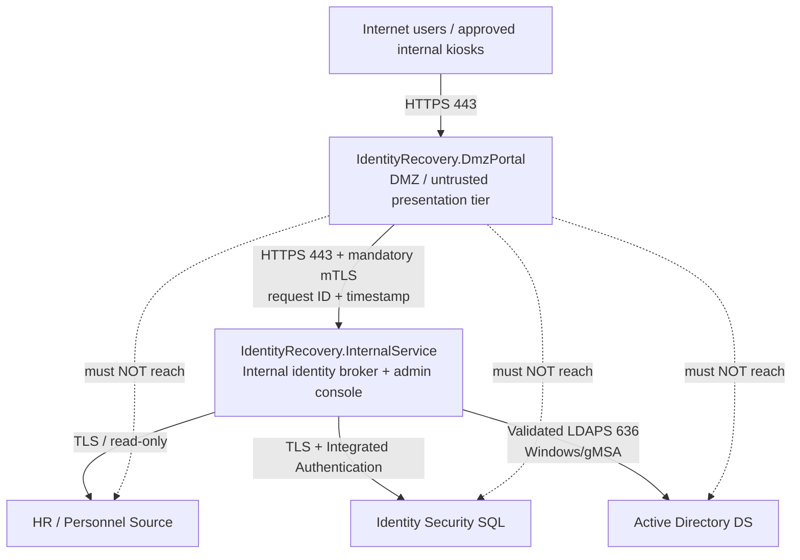

# Identity Recovery & Self-Service Platform
## Deployment and Test Guide

**Target branch:** `feature/identity-recovery-platform-v1`  
**Packages:** `IdentityRecovery.DmzPortal` and `IdentityRecovery.InternalService`  
**Purpose:** deploy the two packages with a hard security boundary, integrate HR/AD safely, and execute functional, security, and recovery acceptance testing before production.

> Production approval requires both packages to pass CI and an isolated real-environment validation. Do not test provisioning or password reset first against production identities.

## 1. Architecture

### Trust model

- Treat the DMZ portal as compromiseable.
- The DMZ portal is not domain joined and contains no reusable AD, HR, SQL, PIN or TOTP credential store.
- The only southbound application route from the DMZ is TCP/443 to the Internal Service.
- The Internal Service is the sole authority for HR lookup, PIN/TOTP verification, AD account selection, password reset, provisioning, RBAC, audit and review workflows.
- The browser never chooses the AD object to reset or provision.

## 2. Package 1 - IdentityRecovery.DmzPortal

### Deployment target

Deploy to a dedicated DMZ Windows/IIS host or hardened reverse-proxy application host.

### Required controls

1. Do **not** domain join the DMZ host.
2. Install the user-facing HTTPS certificate.
3. Install a separate, non-exportable **client-authentication certificate** used only for DMZ-to-Internal mTLS.
4. Restrict the site to HTTPS; redirect/deny plaintext HTTP.
5. Configure exact `AllowedHosts` and trusted reverse-proxy addresses.
6. If redundant nodes are used, configure a shared/recoverable Data Protection key location protected by certificate encryption.
7. For kiosk deployments, enable kiosk mode and apply the OS/browser hardening baseline.
8. Do not install SQL/LDAP administrative tools unless operationally required and explicitly approved.

### Firewall policy

| Source | Destination | Port | Action | Purpose |
|---|---|---:|---|---|
| User networks / Internet | DMZ Portal | TCP 443 | Allow | Portal access |
| DMZ Portal | Internal Service | TCP 443 | Allow | mTLS API only |
| DMZ Portal | AD/DCs | TCP 389/636/3268/3269 | **Deny + log** | Prevent directory access |
| DMZ Portal | SQL/HR | TCP 1433 / HR service ports | **Deny + log** | Prevent data-tier access |
| DMZ Portal | Internal SMB/RDP/WinRM | 445/3389/5985/5986 | **Deny + log** | Prevent lateral movement |
| DMZ Portal | General internal subnets | Any | **Deny + log** | Default deny |

## 3. Package 2 - IdentityRecovery.InternalService

### Deployment target

Deploy to a dedicated **domain-joined** Windows/IIS application server in an internal application-security zone. Do not deploy it on a domain controller.

### Service identity

Use a gMSA or equivalent managed Windows service identity. It must not be Domain Admin, Enterprise Admin, Account Operator, Server Operator or a general-purpose administrative account.

Delegate only the rights required on the intended AD scopes:

- read required user/group attributes;
- reset password on eligible user OUs;
- create users in the configured staging OU;
- move only within approved OUs where policy permits;
- add/remove only approved platform-managed groups;
- write required attributes such as `employeeID` and `pwdLastSet` where applicable.

### Active Directory preparation

Create a staging OU such as:

`OU=Newly Created User,<domain DN>`

Create separate AD security groups for application RBAC and configure their immutable SIDs:

- Platform Admin
- Helpdesk
- Provisioning Admin
- Security Admin
- Auditor

Do not configure individual AD usernames as application administrators.

### Identity Security SQL

1. Create the database.
2. Apply `database/schema.sql`.
3. Grant the Internal Service identity only required permissions.
4. Require encrypted SQL connections with certificate validation.
5. Keep PIN and local-admin peppers outside the database and source tree.
6. Back up the database and Data Protection key material according to the organization's DR policy.

### HR integration

Provide a read-only HR view/API capable of returning the authoritative identity record used by the broker, including the stable HR subject/employee identifier, names, computer/regulation number, email, employment status and employee photograph where available.

The HR source should be read-only to this application unless a separate approved use case requires writes.

## 4. Certificates

Use separate certificates for separate purposes:

1. **Portal server certificate** - browser/user to DMZ Portal.
2. **Internal Service server certificate** - DMZ Portal to Internal Service.
3. **DMZ client certificate** - the Internal Service authenticates the allowed portal identity with mTLS.
4. **Optional Data Protection encryption certificate** - protects shared/recoverable key rings for HA/DR.

Production must not use certificate-validation bypasses such as `TrustAnyCertificate` or `TrustServerCertificate=true`.

## 5. Deployment sequence

1. Confirm CI is green on `feature/identity-recovery-platform-v1`.
2. Build/publish `IdentityRecovery.InternalService` and `IdentityRecovery.DmzPortal` separately.
3. Prepare the isolated test AD OU, test groups and test HR records.
4. Create/delegate the gMSA and verify it cannot administer privileged OUs/groups.
5. Create the Identity Security database and apply `database/schema.sql`.
6. Configure HR read access.
7. Install Internal Service TLS and Data Protection certificates/keys.
8. Deploy Internal Service and verify liveness/readiness.
9. Create/install the DMZ mTLS client certificate and allow-list it on the Internal Service.
10. Deploy DMZ Portal and configure only the Internal Service URL as its southbound dependency.
11. Apply firewall rules and verify negative connectivity tests.
12. Configure AD RBAC group SIDs and add only named test administrators.
13. Configure provisioning profiles, staging OU and positive group allow-lists.
14. Validate recursive privileged-group checks before allowing provisioning.
15. Run the complete acceptance test matrix below.
16. Complete DAST/penetration testing and operational sign-off before production cutover.

## 6. Functional acceptance tests

### A. Existing user - TOTP recovery

- Pre-enroll the test user in TOTP.
- Enter the account identifier.
- Authenticate with TOTP.
- Confirm HR photo/profile.
- Set a new password.
- Verify the exact existing AD `objectGUID` was reset.
- Verify no duplicate AD account was created.
- Verify the transaction cannot be reused.

### B. First-time self-registration with PIN

- Resolve the employee using the configured HR corroboration fields.
- Enter the user's secure PIN.
- Verify the HR profile appears only after PIN authentication succeeds.
- Confirm the profile.
- Enroll an authenticator app by scanning the QR code.
- Enter the first TOTP code and verify enrollment.
- Set the password/reset credential.
- Verify future recovery can use TOTP without exposing the PIN.

### C. Admin-assisted registration

- Helpdesk admin signs in with Windows/AD.
- Locate the HR record.
- Confirm the member against the HR photograph/profile.
- Record the support/visit/ticket reference.
- The **member**, not the admin, privately enters and confirms the PIN in masked fields.
- Verify only the PIN verifier is stored.
- Verify the admin cannot retrieve or display the PIN afterward.
- Verify the member can bootstrap TOTP enrollment with that PIN.

### D. User with no AD account

- Verify HR identity and authentication.
- Confirm the broker finds no authoritative existing AD identity.
- Verify the account is created **disabled** in the staging OU.
- Verify only approved baseline groups are applied.
- Complete required TOTP enrollment and password creation.
- Verify the new AD account is enabled only after the password workflow succeeds.
- Verify the HR subject ID is bound to the new AD `objectGUID`.

### E. Existing/colliding AD identity

- Create an AD record with matching email but a different employee ID.
- Attempt self-service provisioning.
- Expected result: **no new account is created** and the case enters the provisioning review queue.
- Provisioning Admin reviews and records the resolution reason.

## 7. Security acceptance tests

| Test | Expected result |
|---|---|
| Unknown username/computer/regulation number | Generic response; no account-existence disclosure |
| Wrong HR corroboration data | No profile/photo returned |
| Three bad PIN attempts | PIN method locks; enrolled TOTP remains available unless policy disables it |
| TOTP replay | Same timestep/code cannot be reused |
| API request replay | Duplicate request ID is rejected |
| Reset-token replay | Used/expired transaction is rejected |
| Different source/client certificate | Bound transaction is rejected |
| Missing/invalid mTLS client certificate | Internal API access rejected before business logic |
| DMZ -> AD/SQL/HR connectivity | Network connection fails and is logged |
| Privileged AD target | Reset/provisioning denied |
| Nested privileged membership | Reset/provisioning denied through transitive membership detection |
| User-selectable profile not in positive allow-list | Request denied |
| User-selectable group not in positive allow-list | Request denied |
| Helpdesk attempts provisioning-admin action | Access denied |
| Auditor attempts write action | Access denied |
| Local break-glass login without TOTP | Access denied |
| Repeated break-glass failures | Temporary block/throttling and audit event |
| Admin PIN/TOTP/password viewing | Secret is never retrievable |
| SQL/LDAP certificate validation failure | Dependency/readiness fails closed |
| Account collision/ambiguity | Automation stops; review case created |
| Audit update/delete attempt | Audit remains append-only |

## 8. Kiosk acceptance tests

- Kiosk launches only the approved portal URL.
- Browser password saving/autofill is disabled by policy where possible.
- Idle timeout clears the active recovery session.
- Browser history/back-forward cache does not expose the previous user's profile.
- Local storage/session state is cleared at workflow completion and timeout.
- No email, PIN, TOTP code or password remains visible after reset.
- Reboot/logoff returns the kiosk to a clean state.

## 9. Admin and RBAC acceptance tests

Test each AD role with a separate account:

- Helpdesk - member support and assisted registration only.
- Provisioning Admin - provisioning profiles and review queue.
- Security Admin - self-service security state and response controls.
- Auditor - read-only audit search.
- Platform Admin - platform configuration and break-glass custody.

Remove each test user from its AD group and obtain a fresh Windows token; verify access is removed without changing the application database.

## 10. Operational monitoring and rollback

Before cutover confirm:

- liveness/readiness endpoints are monitored;
- SIEM receives critical structured security events;
- audit retention is documented;
- database and Data Protection keys are backed up;
- break-glass password/TOTP custody is documented and separated;
- rollback package and previous configuration are retained;
- gMSA delegated rights can be removed quickly;
- DMZ-to-Internal firewall rule can be disabled quickly in an incident.

## 11. Production sign-off criteria

Production approval requires all of the following:

- CI secret scan, architecture regression checks, Release build, automated tests and dependency vulnerability scan are green.
- Both packages pass readiness checks in the isolated test environment.
- Real gMSA/AD/HR/SQL/certificate integration passes end to end.
- Firewall isolation has been independently verified.
- Privileged-account and nested-group attack tests pass.
- All RBAC roles pass positive and negative authorization tests.
- Kiosk session-cleanup tests pass where kiosk mode is deployed.
- DAST/penetration test has no unresolved critical/high findings.
- Backup/restore of the Identity Security database and Data Protection keys is proven.
- Security/operations owners approve the deployment.

## 12. Recommended test dataset

Use a small isolated set of identities covering at least:

1. existing normal AD user;
2. HR employee with no AD account;
3. employee with email collision;
4. employee with multiple/ambiguous AD matches;
5. user in a blocked privileged group;
6. user nested indirectly into a blocked privileged group;
7. inactive HR employee;
8. enrolled TOTP user;
9. PIN-only first-time user;
10. PIN-locked user;
11. Helpdesk admin;
12. Provisioning admin;
13. Security admin;
14. Auditor;
15. Platform admin;
16. local break-glass admin.

Keep all testing out of production OUs and production identities until the acceptance gates above are complete.
